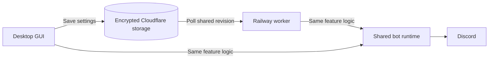

# MetaBot Free All-Rounder Discord Bot

<p align="center">
  
</p>

<p align="center">
  <a href="https://www.python.org/"></a>
  <a href="https://discordpy.readthedocs.io/"></a>
  <a href="https://railway.com/"></a>
  <a href="https://developers.cloudflare.com/"></a>
</p>

**MetaBot** is a free, all-rounder Discord bot with a desktop control panel and a persistent Railway worker. The worker loads the same encrypted settings as the GUI and keeps the bot online.

> The displayed bot name and tagline come from [`bot_app_config.txt`](bot_app_config.txt). The project code name is **MetaBot**.

## What MetaBot can do

| Area | Features |
| --- | --- |
| **Community** | Welcome and goodbye messages, birthday collection and wishes, counting channels, automatic roles, text and voice leveling, leaderboards |
| **Moderation** | Link filtering, blocked-word rules, warning and timeout controls, protected admin account, kick and ban actions |
| **Support** | Ticket dashboard and private channels, moderator assignment and transfer, staff summaries, resolution controls, member ratings |
| **Voice** | Join-to-create temporary rooms, owner controls, member moves, drag permissions |
| **Automation** | Scheduled role notifications, movie announcements, custom GIF slash commands |
| **Control panel** | GUI settings, live logs, database usage, encrypted backup export/import, ticket and moderation controls |

Bot-account anti-spam watches visible server messages for @everyone/@here abuse, mass mentions, rapid bursts, and repeated-message floods. It attempts an immediate ban and sends the configured administrator a reason and action result. The bot cannot inspect private DMs sent by another bot, so DM-only behavior is not observable to this server bot. The Discord bot needs Ban Members permission and a role above the suspected bot.

The GUI has dedicated tabs for Overview, GIF Commands, Chat, Link Send, Drag Permissions, Tickets, Voice, Greetings, Leveling, Counting, Birthdays, Notifications, Movies, Auto Roles, Moderation, Word Block, and Live Logs. The **All Controls** menu makes every tab easy to reach.

### Discord commands

- `/help` opens a private, paginated guide. Its title and command description use the configured bot name.
- `/chat` opens a permission-checked form for posting a message in the current channel.
- `/leaderboard` creates a server XP leaderboard image.
- `/move` guides an authorized member through selecting and moving people between voice channels.
- Custom GIF commands are created in the GUI and appear as server slash commands.
- Ticket staff can DM `start` to view their support rating summary. Duplicate delivery of the same message is claimed in the shared database so it receives one reply.

### Ticket staff have no default

Add moderators in the GUI's **Tickets** tab for each server. MetaBot does not use an administrator ID or an environment variable as fallback ticket staff. If a server has no saved ticket moderators, ticket creation stays disabled until an administrator adds someone in the GUI. Clearing the list disables new tickets again.

## How the GUI and Railway stay in sync



The GUI and Railway worker use the same runtime and Cloudflare store. Railway checks for settings changes every 10 seconds. Keep the same `BOT_CONTROL_ID`, encryption key, Cloudflare database/bucket, and Discord bot token in your local environment and Railway Variables.

**Run only one active Discord gateway connection per token.** Use the desktop GUI to configure the bot, then disconnect it and keep Railway as the live connection. Running both gateway connections can duplicate other Discord events even though the `start` staff summary is deduplicated.

## Quick start

### 1. Prepare the environment

Install Python 3.12, then copy the safe template and install the dependencies:

```powershell
Copy-Item .env.example .env
python -m pip install -r requirements.txt
```

Fill in the values in `.env`:

| Variable | What it is |
| --- | --- |
| `DISCORD_BOT_TOKEN` | Discord application bot token |
| `BOT_ENCRYPTION_KEY` | Fernet key used to encrypt stored bot data |
| `BOT_CONTROL_ID` | Shared data namespace, for example `production` |
| `CLOUDFLARE_ACCOUNT_ID` | Cloudflare account identifier |
| `D1_DATABASE_ID`, `D1_API_TOKEN` | Cloudflare D1 database and API access |
| `R2_ENDPOINT`, `R2_ACCESS_KEY_ID`, `R2_SECRET_ACCESS_KEY`, `R2_BUCKET_NAME` | Private R2 storage access |
| `ADMIN_USER_ID` | Discord account protected from bot kick/ban actions |
| `ALLOWED_GUILD_ID` | The Discord server the bot is configured to serve |

Generate a Fernet key once with:

```powershell
python -c "from cryptography.fernet import Fernet; print(Fernet.generate_key().decode())"
```


### 2. Configure the Discord application

In the Discord Developer Portal, enable **Message Content Intent** and **Server Members Intent**. Invite the bot with the permissions required by the features you enable. Temporary voice room management needs channel management and member move permissions; the generated invite currently requests Administrator permissions for the complete feature set.

### 3. Open the desktop control panel

```powershell
python bot.py
```

The Overview tab reads the token from `.env`. Connect the GUI, choose your server, and save settings in the relevant tabs. Add at least one ticket moderator in the Tickets tab before enabling ticket creation.


### 4. Deploy the Railway worker

Create a Railway project from this GitHub repository and deploy using the included Dockerfile. Set the same runtime variables as the GUI. The included Dockerfile starts `python -m workers.railway`, so Railway can use its default start command. No public web port is needed.


After deployment, disconnect the GUI bot so Railway owns the only active Discord gateway connection.

For Cloudflare setup notes, see [`cloudflare/README.md`](cloudflare/README.md).

## Choose the bot name

Edit `BOT_APP_NAME` and `BOT_APP_TAGLINE` in [`bot_app_config.txt`](bot_app_config.txt). The configured name is used by the desktop window, help command and embeds, backup dialogs, server notices, and hosted worker startup logs. `LOGO_PATH` selects the shared GUI/logo asset.

## Project layout

```text
bot.py                    Desktop GUI entry point
config/                   App name, logo path, and environment configuration
runtime/                  Shared Discord events, commands, and feature runtime
storage/                  Encrypted Cloudflare R2/D1 stores and data operations
workers/                  Shared runtime and Railway worker entry point
features/                 Separate chat, tickets, anti-spam, birthdays, voice, move, help, and leaderboard modules
assets/                   GUI and deployment assets
cloudflare/               Cloudflare schema and setup resources
docs/                     GitHub project artwork
```

The GUI is intentionally kept as the root `bot.py` entry point. Runtime, storage, configuration, worker, and feature code live in their own packages so each area has a clear home.

## Data, backups, and privacy

- Bot settings, logs, moderation state, tickets, and activity records are encrypted before storage.
- GUI and Railway share the same `BOT_CONTROL_ID`; keep the encryption key and Cloudflare configuration consistent.
- **Live Logs** provides database usage and encrypted backup export/import controls.
- Backups contain private bot data. Store them securely and use the same control ID and encryption key when restoring.
- `.env.example` contains placeholders only. Put real API keys, the Discord token, administrator ID, and server ID in `.env` or Railway Variables.

## Troubleshooting

| Problem | Check |
| --- | --- |
| GUI reports missing configuration | Copy `.env.example` to `.env` and fill the required variables. |
| Railway cannot decrypt saved data | Confirm `BOT_ENCRYPTION_KEY` and `BOT_CONTROL_ID` match the GUI environment. |
| Settings do not appear on Railway | Confirm GUI and Railway use the same D1 database, R2 bucket, and control ID; allow one polling interval. Keep one worker replica. |
| Ticket button says staff are missing | Add and save at least one moderator for that server in the GUI's Tickets tab. |
| Bot cannot move or manage members | Check Discord intents, bot permissions, channel overrides, and role hierarchy. |
| The bot replies twice to other events | Make sure only one gateway connection is active for the token. The staff `start` response is separately deduplicated. |

## Contributing

Keep feature code in the package that owns it, keep secrets out of source and screenshots, and update this README when adding a GUI tab, slash command, or environment variable. Please include a clear description of the behavior change in your pull request.
