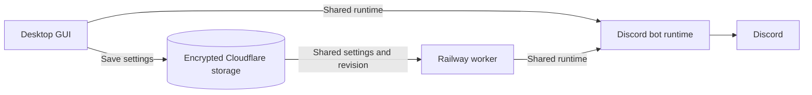

# MetaBot — Free All-Rounder Discord Bot

<p align="center">
  
</p>

<p align="center">
  <a href="https://www.python.org/"></a>
  <a href="https://discordpy.readthedocs.io/"></a>
  <a href="https://railway.com/"></a>
  <a href="https://developers.cloudflare.com/d1/"></a>
  <a href="https://developers.cloudflare.com/r2/"></a>
</p>

**MetaBot is the project codename** for a free, all-rounder Discord bot with a desktop control panel and a persistent Railway worker. Use the GUI to configure features; the worker reads the same shared settings and runs the bot continuously.

The bot's displayed name and tagline can be customized in [`bot_app_config.txt`](bot_app_config.txt). The codebase and this project are referred to as **MetaBot**.

<p align="center"><i>One control panel. A modular bot. Shared settings that follow the bot to Railway.</i></p>

## Contents

- [Features](#features)
- [Commands](#discord-commands)
- [How it works](#how-it-works)
- [Get started](#get-started)
- [Deploy to Railway](#deploy-to-railway)
- [Configuration](#configuration)
- [Security and privacy](#security-and-privacy)
- [Project structure](#project-structure)
- [Troubleshooting](#troubleshooting)
- [Contributing](#contributing)

## Features

| Category | Included features |
| --- | --- |
| **Community** | Welcome and goodbye messages, birthdays and birthday wishes, counting channels, automatic roles, text and voice leveling, XP leaderboards |
| **Moderation** | Link filtering, blocked-word rules, warnings, timeouts, kick and ban tools, protected admin account |
| **Anti-spam** | Detects server spam from bot accounts, including mass mentions, `@everyone`/`@here`, repeated messages, and rapid message bursts; alerts the configured admin when it attempts a ban |
| **Tickets** | Ticket panels and private channels, staff assignment and transfer, staff rating summaries, close controls, member ratings |
| **Voice** | Temporary join-to-create rooms, owner controls, member moves, drag permissions |
| **Automation** | Scheduled role notifications, movie announcements, custom GIF slash commands |
| **Desktop control panel** | Feature settings, connection status, live logs, database usage, encrypted backup export and import |

The desktop GUI groups these controls into tabs for Overview, GIF Commands, Chat, Link Send, Drag Permissions, Tickets, Voice, Greetings, Leveling, Counting, Birthdays, Notifications, Movies, Auto Roles, Moderation, Word Block, and Live Logs. Use **All Controls** in the header to jump between sections.

### Ticket staff are configured in the GUI

There are no default ticket staff and no `TICKET_STAFF_IDS` environment variable. Add staff for each server in the GUI's **Tickets** tab. When the saved staff list is empty, users cannot create tickets. Clearing the list disables ticket creation again.

### Anti-spam behavior

The bot monitors messages it can see in server channels. It can act on observable mention abuse, message bursts, and repeated-message floods. A bot needs the Discord **Ban Members** permission and a role above the spam bot to ban it. Discord does not expose another bot's private DMs to this bot, so DM-only spam cannot be detected here.

## Discord commands

| Command | What it does |
| --- | --- |
| `/help` | Opens a private, paginated feature guide. |
| `/chat` | Opens a permission-checked form to post a message in the current channel. |
| `/leaderboard` | Shows the server's top 10 members by leveling XP. |
| `/move` | Opens a guided flow to move selected members between voice channels. |
| Custom GIF commands | Created in the GUI and registered as server slash commands. |
| DM `start` | Configured ticket staff can request their support rating summary. Duplicate message delivery is claimed in shared storage to avoid duplicate replies. |

## How it works



The GUI and Railway worker use the same bot runtime and Cloudflare-backed store. Railway checks for settings changes about every 10 seconds. Use the same `BOT_CONTROL_ID`, encryption key, D1 database, R2 bucket, and Discord token in both environments.

> Keep only one active Discord gateway connection per bot token. Configure the bot in the GUI, then disconnect the GUI before leaving Railway as the live worker. Running both can duplicate Discord events.

## Get started

### Requirements

- Python 3.12
- A Discord application and bot token
- A Cloudflare D1 database and private R2 bucket
- A Fernet encryption key
- Windows for the desktop GUI; Railway runs the persistent worker from the included Dockerfile

### 1. Prepare local configuration

From the repository folder, copy the template and install dependencies:

```powershell
Copy-Item .env.example .env
python -m pip install -r requirements.txt
```

On macOS or Linux, use `cp .env.example .env` in place of `Copy-Item`.

Generate a Fernet key once:

```powershell
python -c "from cryptography.fernet import Fernet; print(Fernet.generate_key().decode())"
```

Put the generated key and your private service values in `.env`. See [Configuration](#configuration) for the full list. Never commit the real `.env` file.

### 2. Configure the Discord application

In the Discord Developer Portal, enable **Message Content Intent** and **Server Members Intent**. Invite the bot to your server and grant the permissions needed by the features you plan to use. The current generated invite requests Administrator permission for the complete feature set; review bot permissions and role hierarchy in Discord if you use a custom invite.

### 3. Run the desktop GUI

```powershell
python bot.py
```

Connect the bot, select your server, and save settings in the relevant tabs. Add at least one ticket moderator in **Tickets** before enabling ticket creation.

## Deploy to Railway

1. Push the project to a GitHub repository.
2. In Railway, create a project from that repository and deploy with the included `Dockerfile`.
3. Add all required `.env` values under the Railway service's **Variables**. Railway starts `python -m workers.railway` from the Dockerfile; a public web port is not needed.
4. Keep the service at **one replica**.
5. Once Railway is connected, disconnect the GUI bot so the hosted worker is the only active Discord gateway connection.

See [`cloudflare/README.md`](cloudflare/README.md) for Cloudflare storage setup notes.

## Configuration

The `.env.example` file contains placeholder values. Replace them in your local `.env` and add the same values as Railway service variables.

| Variable | Required | Purpose |
| --- | --- | --- |
| `DISCORD_BOT_TOKEN` | Yes | Discord bot token. Treat it like a password. |
| `BOT_ENCRYPTION_KEY` | Yes | Fernet key used to encrypt protected bot data. Keep the same key when restoring data. |
| `BOT_CONTROL_ID` | Yes | Shared data namespace used by the GUI and Railway worker, for example `production`. |
| `CLOUDFLARE_ACCOUNT_ID` | Yes | Cloudflare account identifier. |
| `D1_DATABASE_ID` | Yes | Cloudflare D1 database identifier. |
| `D1_API_TOKEN` | Yes | Token with the required D1 API access. |
| `R2_ENDPOINT` | Yes | Cloudflare R2 S3-compatible endpoint. |
| `R2_ACCESS_KEY_ID` | Yes | R2 access key ID. |
| `R2_SECRET_ACCESS_KEY` | Yes | R2 secret access key. |
| `R2_BUCKET_NAME` | Yes | Private R2 bucket used by the bot. |
| `ADMIN_USER_ID` | Yes | Numeric Discord user ID protected from bot kick/ban actions and used for anti-spam alerts. |
| `ALLOWED_GUILD_ID` | Yes | Numeric Discord server ID this bot instance is configured to serve. |

Ticket staff are intentionally **not** configured here. Manage them per server from the GUI.

To change the displayed bot name or tagline, edit `BOT_APP_NAME` and `BOT_APP_TAGLINE` in [`bot_app_config.txt`](bot_app_config.txt). `LOGO_PATH` selects the logo asset used by the GUI and worker.

## Security and privacy

- Keep `.env`, Railway variables, Discord tokens, Cloudflare credentials, and Fernet keys private. `.gitignore` excludes `.env`; verify your repository contains placeholders only before publishing.
- Do not put administrator IDs, server IDs, tokens, or storage keys into Python source, screenshots, issues, or README examples. Use environment variables.
- Rotate any credential that was accidentally published, and remove it from the repository's current files and history where possible. Deleting a secret from the latest commit does not revoke it.
- The Fernet key is required to decrypt protected data and backups. Store it securely and do not rotate it without first planning how existing encrypted data will be migrated.
- Backups can contain private server and member data. Store exported files securely and restore them with the original `BOT_CONTROL_ID` and encryption key.
- Review Cloudflare permissions and Discord bot permissions periodically; grant the bot only the access your chosen features need.

## Project structure

```text
bot.py                    Desktop GUI entry point
bot_app_config.txt        Public display name, tagline, and logo path
config/                   Shared application configuration
features/                 Separate chat, tickets, anti-spam, birthdays, voice, and command UI modules
runtime/                  Shared Discord events, commands, and feature orchestration
storage/                  Cloudflare D1/R2 stores and data operations
workers/                  Shared persistent worker and Railway entry point
cloudflare/               Storage schema and setup notes
docs/                     GitHub project artwork
assets/                   GUI and deployment assets
```

The root `bot.py` remains the desktop entry point. Feature screens and components live in `features/`, shared event handling lives in `runtime/`, and Railway startup code lives in `workers/`.

## Troubleshooting

| Symptom | What to check |
| --- | --- |
| Railway exits with an `ADMIN_USER_ID` error | Add your numeric Discord user ID under Railway service **Variables**, then redeploy. |
| Railway exits with an `ALLOWED_GUILD_ID` error | Add the numeric ID of the Discord server the bot should serve. |
| GUI reports missing configuration | Copy `.env.example` to `.env` and fill all required values. |
| Railway cannot decrypt saved data | Confirm `BOT_ENCRYPTION_KEY` and `BOT_CONTROL_ID` match the GUI values exactly. |
| GUI changes do not appear in Railway | Confirm both use the same D1 database, R2 bucket, and control ID; allow a sync interval and keep one Railway replica. |
| Ticket creation says staff are missing | Add and save at least one moderator for that server in the GUI's Tickets tab. |
| Bot cannot move or manage members | Check enabled intents, channel permissions, bot permissions, and role hierarchy. |
| Events or messages appear twice | Disconnect the GUI bot and check Railway is running only one replica. |

## Contributing

Keep feature code in its owning module, protect secrets and member data, and update this README when commands, GUI tabs, configuration, or deployment behavior changes. Include a concise description of the user-visible change in your pull request.

---

<p align="center"><b>MetaBot</b> — a configurable Discord community toolkit, with the desktop control panel and Railway worker sharing one source of truth.</p>
